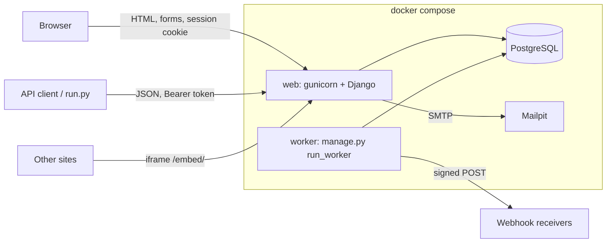

# Architecture

Banana Hat is a server-rendered Django application with a REST API beside it, one
PostgreSQL database, and a background worker. There is no JavaScript build, no message
broker, no cache server and no external service. That list of absences is the design:
every one of them is something an organizer would otherwise have to run on Monday.

- [Shape](#shape)
- [Code layout](#code-layout)
- [How a request is decided](#how-a-request-is-decided)
- [Deadline enforcement](#deadline-enforcement)
- [The audit chain](#the-audit-chain)
- [Webhooks: the transactional outbox](#webhooks-the-transactional-outbox)
- [Signed records](#signed-records)
- [Security headers and the browser](#security-headers-and-the-browser)
- [Operations](#operations)
- [Decisions, and what we rejected](#decisions-and-what-we-rejected)

## Shape



- **web** runs migrations, seeds (in demo mode) and serves gunicorn with threads. Static
  files are collected at build time and served by WhiteNoise with far-future cache
  headers. Nothing is fetched from a CDN, fonts included (the CSS uses system fonts).
- **worker** is the same image with a different command. It delivers webhooks from the
  outbox and purges expired rate-limit counters. Losing it delays webhooks; nothing else
  depends on it.
- **db** is PostgreSQL 17. The same code runs on SQLite (`DATABASE_URL=sqlite:///...`)
  for tests and single-container installs.
- **mailpit** catches mail in the demo so invitations, ballot links and password resets
  can be read at `localhost:8025` with the network off. In production, point
  `EMAIL_HOST` at a real SMTP server.

The database is the only stateful component, apart from the generated `SECRET_KEY` in
the `/data` volume. Backup is `pg_dump`, plus that key.

## Code layout

```
src/
  bananahat/     settings (all from the environment), root URLs, WSGI
  core/          access decorators, default-deny middleware, security headers,
                 domain errors, public ids, clock, DB-backed rate limiting
  accounts/      User, API tokens, bearer auth, sign-in/up, password reset, demo accounts
  events/        Event, Track, Prize, EventRole, Team, Project
                   access.py    every role question, answered in one place
                   services.py  teams, submissions, deadlines, roles
                   console.py   organizer operations on the event itself
  judging/       rubric, invitations, assignment, scoring, results, pairwise
                   stats.py     the math: pure Python, no Django
  voting/        ballots, community vote, comments, abuse heuristics
  integrations/  fixture-format import/export, webhooks + worker
  records/       Ed25519 keys, signed records, certificates
  api/           REST API v1 (DRF): serializers and views over the services
  console/       organizer console views
  templates/, static/
tools/           verify_record.py (standalone Ed25519 verifier), check_extended.py
tests/           pytest suite, including the official run.py against a live server
```

The layering rule: **views never write models directly.** HTML views and API views call
the same service functions (`events.services.update_project`,
`judging.scoring.submit_score`, `voting.services.cast`, ...). A service checks
permissions and invariants, writes, and records an audit entry, all in one transaction.
It raises a `DomainError` subclass on refusal, which carries an HTTP status and a stable
code. The API turns it into `{"error": {"code": "submissions_closed", "message": ...}}`;
an HTML view turns it into a message on the page. One refusal, one reason, whichever
door the request came through. The Django admin is **read-only** for judging data
(events, projects, scores, ballots, the audit trail), so it cannot be a side door either;
it can edit accounts and platform permissions.

## How a request is decided

Three layers, each of which would stop a leak on its own.

**1. Every door declares who may use it, and the default is no.**

- HTML views are decorated with `@public`, `@authenticated` or `@staff`
  ([`core/access.py`](src/core/access.py)). `AccessPolicyMiddleware` refuses (403) any
  view without a declaration, so forgetting to think about access fails closed.
- API views name their DRF `permission_classes`. The project default is `DenyAll`.
- [`tests/test_access_matrix.py`](tests/test_access_matrix.py) walks every URL pattern
  and fails the build if any HTML view is undeclared, or any API view relies on a
  default permission.

**2. Object-level questions have one answer.**
[`events/access.py`](src/events/access.py) answers "is this user an organizer of this
event? a judge? on which team?" from the `EventRole` table, cached per request. Views and
services call it. They never infer a role from a URL, a template variable or a hidden
form field.

**3. Data is scoped before it is fetched.** `Score.objects.visible_to(user)` returns a
judge's own scores, all scores of events the user organizes, or nothing. Every view that
returns scores starts from it, and the API additionally refuses outright (403) a request
naming another judge. This is why the official checker's "judge cannot see peer scores"
passes: the backend never had the rows to leak.

**Authentication.** Browsers use Django sessions (HttpOnly, SameSite=Lax, CSRF-protected
forms). API clients use `Authorization: Bearer bh_...` tokens that users create on their
account page. Tokens are shown once, stored as SHA-256 digests, expire and can be
revoked. Bearer requests skip CSRF by design, because a browser never attaches them on
its own, which is also why the checker's late POST reaches the deadline check instead
of failing on CSRF. Unauthenticated API requests get 401 with `WWW-Authenticate: Bearer`.

## Deadline enforcement

"Deadline enforcement that actually holds" means there is one function that decides,
and nothing that writes a project goes around it:

```python
# events/services.py
def ensure_team_can_edit(event, team, at=None):
    at = at or clock.now()
    if at < event.submissions_open_at: raise SubmissionsNotOpen(...)
    if at >= deadline_for(event, team):  raise SubmissionsClosed(...)   # 403
```

- `create_project`, `update_project`, `submit_project`, `unsubmit_project`,
  `create_team`, `join_team` and `leave_team` all call it first. The API view calls it
  before even validating the request body, so a late request is refused *as late*,
  whatever else is wrong with it (there is a test for exactly this).
- `deadline_for` includes a per-team `SubmissionExtension`, which only an organizer can
  grant, with a reason that goes in the audit log.
- The deadline is the minute in the database. A test moves the clock to one second
  before (accepted) and to the deadline itself (refused).
- The only writer that skips it is the fixture importer, which loads history and says so
  in the audit log (`source: import`).

## The audit chain

[`audit/services.py`](src/audit/services.py). Each `AuditEntry` stores the digest of the
entry before it, and its own SHA-256 digest covers that link plus its timestamp, actor,
event, action, target, summary and data. Appending locks the single `AuditChainHead`
row, so concurrent writers serialise, and it happens inside the same transaction as the
change it describes: there is no moment when a score changed and the log does not say so.

`verify_chain()` walks the chain and reports the first entry that was edited, removed,
or cut off the end. The organizer's audit page runs it on every load and shows
"Chain intact: N entries verified". A test edits one row with a raw `UPDATE` and checks
that it is caught.

This is tamper-evident, not tamper-proof: someone with database access could rewrite the
whole chain. So the head digest is included in the signed results record at publication.
After that, rewriting history means the signed record no longer matches, and the signed
record has left the building.

Summaries are written for organizers at the time of the event ("Wei Lindqvist changed
their score for Salt Ledger: Quality 3→4"), with structured `before`/`after` in `data`.
Ballot entries record that a ballot was cast, never what was on it, because organizers
can read the log during voting and the tally must stay hidden.

## Webhooks: the transactional outbox

`webhooks.emit()` writes a `WebhookDelivery` row inside the transaction that makes the
change. If the change rolls back, no webhook is ever sent (tested). If it commits, the
worker delivers it:

- claims due rows in a short transaction (`SELECT ... FOR UPDATE SKIP LOCKED` on
  PostgreSQL) by pushing their next attempt one lease into the future, then makes the
  HTTP calls outside any transaction, so a slow receiver holds no lock;
- signs each body: `X-BananaHat-Signature: t=<unix>,v1=<hex HMAC-SHA256(secret, "t.body")>`,
  so receivers can verify and reject replays older than five minutes;
- retries failures with exponential backoff (30 s, 1 min, 2 min, ... capped at 6 hours) up
  to `WEBHOOK_MAX_ATTEMPTS`, then marks the delivery dead;
- refuses receivers that resolve to private, loopback or link-local addresses, and does
  not follow redirects, so an organizer cannot aim the portal at its own database or a
  metadata service (SSRF).

Event types: `project.submitted`, `project.withdrawn`, `judging.progress` (counts only,
never scores), `results.published`, `results.unpublished`, `comment.created`, `ping`.

## Signed records

[`records/services.py`](src/records/services.py). The portal has an Ed25519 key pair,
generated on first use. The public key is published at
`/.well-known/bananahat-keys.json` in JWK form; the private key is stored encrypted with
a key derived from `SECRET_KEY`. A record is sorted-key compact JSON (the exact signed
bytes are stored, so verification never depends on re-serialising) plus a signature.

Three kinds are signed: the published **results** (with the audit head digest), every
judge's **participation record** (with a salted commitment to their scores), and
participants' **certificates**. Anyone can verify one with
[`tools/verify_record.py`](tools/verify_record.py), a standard-library script that
implements Ed25519 verification from RFC 8032 in about 70 lines, so checking a record
requires trusting neither this server nor a crypto library.

## Security headers and the browser

- `Content-Security-Policy`: scripts from our own origin only. There is no inline
  JavaScript and no inline event handler anywhere, which is what makes that enforceable.
  `frame-ancestors 'none'` everywhere except `/embed/`.
- `X-Frame-Options: DENY` (except the widget), `nosniff`, `Referrer-Policy: same-origin`,
  `Cross-Origin-Opener-Policy`, `Permissions-Policy`.
- Cookies are HttpOnly and SameSite=Lax; set `SECURE_COOKIES=true` behind TLS.
- The JavaScript that exists (about a hundred lines in `static/js/app.js`) is progressive
  enhancement: a deadline countdown, the scorecard's live weighted total, and the
  dashboard's five-second refresh. Every page works without it.

## Operations

- **Configuration** is environment variables only; see the README table. There is one
  settings file for every environment.
- **Health**: `GET /healthz` checks the database. The image's `HEALTHCHECK` uses it, and
  the worker starts only once web is healthy.
- **Migrations** run on container start. They are plain Django migrations and work
  forwards on SQLite and PostgreSQL alike.
- **Scale.** One event is small data: the fixture is 122 reviews. Results are computed
  on request (the judge-effect fit is a 30 × 30 linear solve, about 25 ms) and never
  cached, so they are never stale. Gunicorn workers are stateless; add more with
  `WEB_CONCURRENCY`. Rate limits and DRF throttles use the database, so they hold across
  workers.
- **Logs** go to stdout; gunicorn access logs are on.

## Decisions, and what we rejected

| Decision | Why | Rejected |
|---|---|---|
| Django + PostgreSQL | Boring, known to most self-hosters, batteries included: sessions, CSRF, password hashing, migrations, admin. The organisers' advice was to pick the boring stack. | A SPA + API server: two builds and a second language for the same result. |
| Server-rendered HTML, no JS build | Fast, accessible, works offline, nothing to rebuild. | React/Vite: a toolchain an organizer must keep alive. |
| Services own every write | One place per rule, so the HTML form and the API cannot disagree. | Logic in model `save()` or in views. |
| Phases computed, not stored | A deadline cannot be left open by a forgotten flag. | `Event.status` plus a cron job. |
| Default deny, tested structurally | A new endpoint cannot ship open by accident. | Relying on reviewers to notice a missing check. |
| Scoped querysets for scores | A missing filter cannot leak rows that were never fetched. | Filtering in each view. |
| Judge-effect normalization by default | Smallest worst-case error across realistic events ([JUDGING.md](JUDGING.md)). | Z-scores (wrong when tracks differ), raw means (wrong when judges differ). |
| Transactional outbox for webhooks | No lost or phantom events, and no broker to run. | Sending inside the request; Celery + Redis. |
| Hash-chained audit log | Tampering is detectable, and the head is anchored in signed results. | A plain log table; an external ledger service (a hosted dependency). |
| Ed25519 via `cryptography`, verifier in pure Python | Standard signing; verification needs nothing but Python. | JWTs (easy to misuse); PGP (heavy). |
| Fixture format as the interchange format | Every DOGFOOD portal reads it, so migrating in and out works on day one. | A bespoke schema only we understand. |
| System fonts | No font files, no CDN, instant render, looks native everywhere. | Web fonts: a download or a hosted dependency. |
| DB-backed rate limits | Works across workers with no Redis. | Per-process memory (wrong with several workers), Redis (one more service). |
