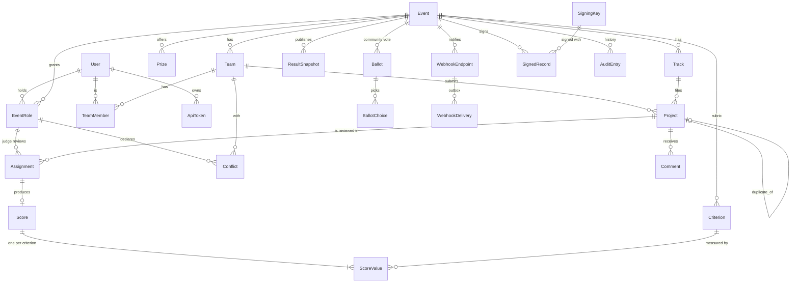

# Data model

PostgreSQL in production, SQLite for tests and single-container installs, with the same
Django migrations for both. Every rule below that can be a database constraint is one,
so a bug in a view cannot break it. Each constraint is named in the migrations; grep for
the name to find it.

- [Diagram](#diagram)
- [Conventions](#conventions)
- [Tables](#tables)
- [Constraints worth defending](#constraints-worth-defending)
- [Import and export](#import-and-export)
- [Retention and deletion](#retention-and-deletion)

## Diagram

## Conventions

**Two identifiers.** Every row has an integer primary key for joins, and user-facing
rows also have a `public_id` for URLs and the API, in the Stripe style: a type prefix
plus 12 random base32 characters (`prj_4k9w2m7q8x1d`). The prefix makes a pasted id
self-describing, and the randomness leaks neither row counts nor creation order.
Public ids are minted when the object is constructed, not in `save()`, so
`bulk_create` cannot produce a row without one.

**`external_id`** keeps the id a row had in the file it was imported from (`prj_01`).
Fixture ids are only unique within one file, so a second import of the same fixture gets
fresh `public_id`s, but exports always write the `external_id`. That is what makes the
round trip lossless.

**Time.** Every timestamp is `timestamptz`, stored in UTC. The application reads the
clock in one place (`core.clock.now`), which is how the tests move time to exactly one
second before a deadline.

**Nothing phase-like is stored.** There is no `status = "judging"` column on an event.
"Are submissions open?" is computed from `submissions_open_at`, `submissions_close_at`
and the clock on every request. There is no flag to forget to flip, and no cron job
whose failure reopens an event.

**Secrets are digests.** API tokens, judge invitations, ballot links and email
verification tokens are stored as SHA-256 digests. A database dump contains no usable
credential. Voter identities are HMAC-SHA256 digests keyed with `SECRET_KEY`, so the
ballot table never holds an email address in clear, and cannot be reversed by guessing
likely addresses.

## Tables

### accounts

| Table | Purpose | Notes |
|---|---|---|
| `User` | A person. Email is the login. | Case-insensitive unique email (`user_email_ci_unique`). `is_staff` = platform admin. `can_create_events` lets a non-admin create events. Imported people start with no usable password and claim the account through the reset link. |
| `ApiToken` | Bearer tokens. | `digest` unique; `prefix` kept in clear so users can tell tokens apart; `expires_at`, `revoked_at`, `last_used_at` (touched at most once a minute). |

### events

| Table | Purpose | Notes |
|---|---|---|
| `Event` | A hackathon. | Dates, scale, review target, normalization method, voting mode and window, `results_published_at`, `is_listed` (drafts are private). Check constraints order the windows (see below). |
| `Track` | A category of projects. | Name unique per event, case-insensitively. |
| `Prize` | Overall or per track. | `winner` filled at publication from the frozen ranking. |
| `EventRole` | What a person may do in an event: `organizer`, `judge` or `participant`. | Unique per (event, user, role). `tracks` (judges only): the tracks they review; empty means all. The five roles of the brief map as visitor = no row, participant/judge/organizer = a row, admin = `User.is_staff`. Roles are per event because people are: the judge at one hackathon competes in the next. |
| `Team` | A team in one event. | `invite_code` is the invite link; rotating it revokes the old link. Names are **not** unique: the fixture has three teams called StillTrail. New teams get a friendly uniqueness check in the form. |
| `TeamMember` | Membership. | Repeats `event` from the team so the database can enforce `one_team_per_event`. |
| `Project` | A submission. | `status` draft/submitted/withdrawn; `submitted_at`; `duplicate_of`. See `one_live_project_per_team` below. |
| `SubmissionExtension` | One team may edit past the deadline. | One per team, with a reason and who granted it. |

### judging

| Table | Purpose | Notes |
|---|---|---|
| `Criterion` | A rubric line. | Relative `weight > 0`; `key` unique per event and stable across exports. |
| `JudgeInvitation` | Emailed single-use link. | Token digest, tracks, expiry, accepted/revoked. |
| `Assignment` | Judge × project: the unit of judging work. | Unique per pair; status pending/done/recused; `source` auto/manual/import. |
| `Score` | A judge's review. | One-to-one with its assignment, so "who wrote this score" can never disagree with "who was assigned". `voided_at` + reason instead of deletion. |
| `ScoreValue` | One criterion's value. | Unique per (score, criterion). Relational rather than a JSON blob, so a criterion cannot be deleted while scores use it (`PROTECT`), and per-criterion analysis is plain SQL. |
| `Conflict` | Declared conflict of interest, judge × team. | Assignment never pairs them again. |
| `PairwiseComparison` | Pairwise mode: winner, loser, judge. | `winner != loser`. |
| `ResultSnapshot` | Published results, frozen JSON. | The public reads only this. |

### voting

| Table | Purpose | Notes |
|---|---|---|
| `Ballot` | One voter's ballot in one event. | `identity_digest` = HMAC of user id, canonical email, or ballot link; unique per event. `status` pending/counted/flagged/void, `flags` (why it was held), hashed network and device fingerprints, `shuffle_seed` (its private project order). |
| `BallotChoice` | A pick. | Unique per (ballot, project). |
| `BallotToken` | A printed ballot link or an email verification link. | Digest only. |
| `Comment` | Public comment. | Hidden by organizers with a reason, never deleted. |

### audit, integrations, records, core

| Table | Purpose | Notes |
|---|---|---|
| `AuditEntry` | Hash-chained history. | `prev_digest` + `digest` (SHA-256 over the canonical entry), an organizer-readable `summary`, structured `data`. |
| `AuditChainHead` | One row: the latest digest. | Writers lock it to append in order; a check constraint keeps it a singleton. |
| `WebhookEndpoint` | Receiver URL, event types, signing secret. | The secret has to be retrievable to sign, so it is stored as is (see limitations in README). |
| `WebhookDelivery` | The outbox. | Status, attempts, next attempt, last error. |
| `SigningKey` | The portal's Ed25519 keys. | Public key in clear; private key encrypted with a key derived from `SECRET_KEY`. Retired keys stay listed. |
| `SignedRecord` | Signed statements: results, judge participation, certificates. | `canonical` holds the exact signed bytes. |
| `RateLimitCounter` | Fixed-window counters. | Keyed by digest, never a raw IP. |

## Constraints worth defending

| Constraint | What it guarantees | Why in the database |
|---|---|---|
| `one_live_project_per_team`: unique `team` where `duplicate_of IS NULL AND status <> 'withdrawn'` | A team competes with one project per event. | A partial unique index says exactly this and nothing more. Duplicates that already exist (the fixture has one) are kept, pointed at the original, and excluded. Swapping which copy competes is done in an order that never violates the index. |
| `one_team_per_event`: unique (event, user) on `TeamMember` | Nobody is on two teams in one event. | Two simultaneous "join" clicks cannot both succeed. |
| `one_ballot_per_voter`: unique (event, identity_digest) | One identity, one ballot. | Race-free, and the form's friendliness cannot weaken it. |
| `one_assignment_per_pair`, `one_value_per_criterion`, `one_conflict_per_pair`, `one_choice_per_project` | No double counting. | |
| `submitted_project_has_timestamp` | A submitted project always has `submitted_at`. | Deadline audits depend on it. |
| `project_not_duplicate_of_itself`, `comparison_distinct` | No self-reference. | |
| `event_submission_window_ordered`, `event_voting_window_ordered`, `event_score_range_ordered` | Close after open; max above min. | |
| `criterion_weight_positive`, `score_value_sane` | Weights > 0; values within the widest scale. | The exact range per event is checked by the service. The database guarantees nothing absurd gets in. |
| `user_email_ci_unique` | `Ada@x.org` and `ada@x.org` are one account. | |
| `verify_token_has_ballot` | An email verification token always belongs to a ballot. | |

Cross-table rules the database cannot express, such as "an assignment's judge and
project belong to its event" or "a judge may not also compete", live in one service
each (`judging.assignment.assign`, `events.services.grant_role`) and are covered by tests.

## Import and export

The interchange format is **the DOGFOOD fixture format**, the one data shape every portal
in this hackathon already reads. Code: [`src/integrations/interchange.py`](src/integrations/interchange.py).

**In.** `python src/manage.py seed --fixtures file.json`, the console's Import page, or
`POST /api/v1/events/import` with the JSON body. The importer:

1. validates the whole document first and reports **every** problem with its path
   (`projects[3].team: unknown team 'tm_99'`), not just the first;
2. loads everything in **one transaction**: all of it or none of it;
3. derives what the fixture does not say: the opening time (72 hours before the
   deadline, or earlier if a submission proves it), and the rubric (the criteria the
   scores use, equal weights);
4. creates accounts for every email it sees, with no password (they claim the account
   through the reset link), and roles for judges and team members;
5. keeps awkward data and flags it instead of dropping it: second projects from a team
   become `duplicate_of` the first; name clashes, cross-team repository reuse, scores
   outside a judge's tracks and scores by a team's own member all produce warnings;
6. writes one `event.imported` audit entry with the counts and every warning.

**Out.** `GET /api/v1/events/{id}/exports/event.json` (console: Data tab) writes the
fixture format **plus** extra keys a fixture reader ignores: `criteria` (with weights),
`prizes`, `assignments` (pending reviews), `event.submissions_open`, `score_scale`,
`slug`, and per-project `status`, `duplicate_of`, `description`, `demo_url` and
`video_url` when they are set. `tests/test_interchange.py` proves two things against the
real `fixtures.json`: exporting the seeded event reproduces every fixture key exactly,
and exporting, re-importing as a new event and exporting again is lossless.

Also exported, for spreadsheets: `scores.csv` (one row per review, with the weighted
total and whether it counts), `results.csv` (ranking, raw mean, interval, rank in
track), `projects.csv` (including drafts and duplicates), and the audit trail as CSV.

**Whole-database** backup and migration is standard PostgreSQL:
`docker compose exec db pg_dump -U bananahat bananahat > backup.sql`. Keep `SECRET_KEY`
(or the `/data` volume that holds the generated one) with it, since the signing key is
encrypted with it.

## Retention and deletion

Nothing that judging depends on is ever hard-deleted by the application:

- scores are **voided** (with a reason), not deleted;
- projects are **withdrawn**, duplicates **flagged**;
- comments are **hidden**, ballots **voided**;
- published results are **snapshotted**, and unpublishing keeps the snapshot;
- the audit trail is append-only, and a gap or an edit breaks the hash chain.

Deleting an event (admin only, in `/admin`) cascades to everything in it except its
audit entries, which keep their text and lose only the foreign key.
